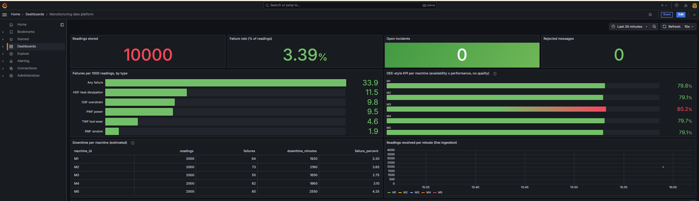
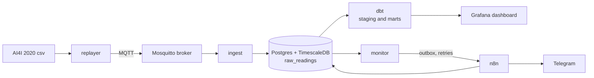

# mfg-data-platform

A small manufacturing data platform that runs on one laptop with Docker. Machine
readings are sent over MQTT, stored in a time-series database, turned into KPIs
with dbt, shown in Grafana, and watched by a monitor that sends alerts through n8n
and Telegram when a sensor breaks.



*Grafana dashboard (public AI4I data, loaded with `scripts/load_sample.py`)*

**Data note: public data, synthetic timing.** The readings come from the public
UCI AI4I 2020 dataset. That dataset has no timestamps and no machine ids, so the
replayer invents both: the rows are shared between five machines and each row is
10 seconds after the previous one. The machine ids M1 to M5 are assigned by the
replayer, so differences between machines in the dashboard are not real. The faults
used in the tests and benchmarks are simulated by my own replayer and found by my own
monitor. This project is a rebuild of a pattern on public
data. It is not a production system and makes no claim about a real plant.

## How it works



| Part | What it does |
| --- | --- |
| `replayer/` | Reads the CSV and publishes one reading at a time at a fixed rate. Can inject faults. |
| `ingest/` | Subscribes to MQTT, checks the shape of each message and stores it. Repeated readings are stored once. |
| `monitor/` | Looks for silent machines, stuck sensors (torque, rotational speed, process temperature) and out-of-range values. Writes alerts to an outbox table and delivers them to n8n, retrying if n8n is down. |
| `dbt/` | Cleans the raw data and builds three KPI tables, with tests. |
| `n8n/workflows/` | The alert flow, exported as JSON without secrets. n8n only delivers; all decisions are made in tested Python or dbt. |
| `grafana/` | Data source and dashboard, provisioned from files. |
| `benchmark/` | Measures detection delay and compares the monitor with a simple baseline. |
| `docs/learn/` | Plain-language notes for each week: concepts, code walkthrough, interview questions, glossary. |

## Run it

You need Docker Desktop, Python 3.11 and Git.

```bash
# 1. Settings. Edit the passwords in .env.
cp .env.example .env

# 2. Credentials for n8n, built from .env.
python scripts/make_n8n_credentials.py

# 3. Start the stack. The demo profile adds a fake Telegram that prints messages.
docker compose --profile demo up -d --build

# 4. Send data: 2000 readings at 50 per second.
docker compose run --rm replayer --rows 2000 --rate 50

# 5. Build the KPI tables and run the dbt tests.
docker compose run --rm dbt build
```

Open Grafana at http://localhost:3000 (user `admin`, password from `.env`). The
dashboard "Manufacturing data platform" is the home page. n8n is at
http://localhost:5678.

Use `python scripts/load_sample.py --rows 10000` to fill the database straight
from the CSV without waiting for MQTT.

### Break a sensor and watch the alert

```bash
# Machine M3 goes silent after 500 rows. Other options: sensor_stuck, out_of_range
docker compose run --rm replayer --fault silence --fault-start-row 500 --rate 10
```

The monitor notices, writes the alert to the outbox, n8n logs the incident and
sends the message. With the demo profile you can read it with
`docker compose logs fake-telegram`. Incidents show in the dashboard and in the
`incidents` table.

### Use a real Telegram bot

1. Create a bot with @BotFather and copy the token.
2. Send your bot a message, then open `https://api.telegram.org/bot<TOKEN>/getUpdates` to find your chat id.
3. Put `TELEGRAM_BOT_TOKEN` and `TELEGRAM_CHAT_ID` in `.env` and set `TELEGRAM_BASE_URL=https://api.telegram.org`.
4. Run `python scripts/make_n8n_credentials.py` again and recreate n8n with
   `docker compose up -d --force-recreate n8n`. n8n updates its saved credentials
   when it starts. Do not start the `demo` profile.

### Running it more than once

- Ingestion skips readings it has already stored, and an open incident blocks a new
  alert for the same machine and type. To start clean, empty the tables:

  ```bash
  docker compose exec timescaledb psql -U mfg -d mfg -c "TRUNCATE raw_readings, rejected_readings, incidents, outbox RESTART IDENTITY;"
  ```

- After changing `.env`, run `python scripts/make_n8n_credentials.py` and then
  `docker compose up -d --force-recreate n8n`. n8n reads its credentials only when it
  starts.
- Without `--rows` the replayer never stops. Always give `--rows`.
- After a replay ends, every machine raises a silence alert after about 60 seconds.

### Testing the failure case

This checks that a failed Telegram call is retried and the message is sent once. It uses
the fake Telegram server of the demo profile, so no message reaches a real bot. These steps
were run on 22 Oct 2026 against the fake server.

1. In `.env`, point Telegram at the fake server and keep the real URL as a comment:

   ```
   # TELEGRAM_BASE_URL=https://api.telegram.org
   TELEGRAM_BASE_URL=http://fake-telegram:8081
   ```

2. Rebuild the n8n credentials and recreate n8n, because it reads them at start:

   ```powershell
   python scripts/make_n8n_credentials.py
   docker compose --profile demo up -d
   docker compose --profile demo up -d --force-recreate n8n
   ```

3. Make the first Telegram request fail, then empty the tables and replay a fault:

   ```powershell
   $env:FAKE_TELEGRAM_FAIL_FIRST = "1"
   docker compose --profile demo up -d --force-recreate fake-telegram
   docker compose exec timescaledb psql -U mfg -d mfg -c "TRUNCATE raw_readings, rejected_readings, incidents, outbox RESTART IDENTITY;"
   docker compose run --rm replayer --rows 300 --rate 50 --fault out_of_range --fault-start-row 100
   ```

4. Look at the results:

   ```powershell
   docker compose logs fake-telegram
   docker compose exec timescaledb psql -U mfg -d mfg -c "select id, machine_id, incident_type, attempts, delivered_at from outbox order by id"
   docker compose exec timescaledb psql -U mfg -d mfg -c "select id, machine_id, incident_type, status, outbox_id from incidents order by id"
   ```

   What was measured: request 1 got HTTP 500, the retry sent the same text once with
   HTTP 200, `delivered_at` was set only after that, and there was exactly one incident.
   The text kept `air_temp_k` with its underscores (`parse_mode=HTML`).

5. Run it again with `$env:FAKE_TELEGRAM_FAIL_FIRST = "0"` after recreating the fake
   server and emptying the tables. One alert was sent once. A second outbox row for the
   same machine and type, inserted by hand while the incident was open, was marked
   delivered without a new message and without a second incident.

6. To go back to the real bot, swap the two `TELEGRAM_BASE_URL` lines in `.env`, run
   `python scripts/make_n8n_credentials.py` and `docker compose up -d --force-recreate n8n`,
   and remove the variable with `Remove-Item Env:FAKE_TELEGRAM_FAIL_FIRST`.

Before the retry change, the real bot was checked by hand once. The retry change and the
new alert text have not been checked on the real bot yet.

### Tests

```bash
python -m venv .venv
.venv/Scripts/pip install -r requirements-dev.txt     # on Linux/macOS: .venv/bin/pip
docker compose up -d timescaledb
.venv/Scripts/python -m pytest
```

The tests create their own database called `mfg_test`, so your data is never touched.
GitHub Actions runs the same tests, the dbt build and a check of the compose file on every push.

## Results

All numbers below are measured, not estimated.

### Does the monitor beat a simple baseline?

The baseline is the obvious first idea: alert only when a machine stops sending data.
Run with `python benchmark/detection_delay.py` (simulated time, no Docker). The fault
starts 30 seconds into a 200 second replay at 10 messages per second.

| Fault | Monitor: detection delay | Baseline (silence only): detection delay | False alarms (monitor / baseline) |
| --- | --- | --- | --- |
| silence | 60.0 s | 60.0 s | 0 / 0 |
| sensor_stuck | 5.0 s | not detected | 0 / 0 |
| out_of_range | 5.0 s | not detected | 0 / 0 |
| none (clean run) | - | - | 0 / 0 |

The baseline cannot see a frozen or broken sensor that keeps sending data. The
monitor finds a broken value at its next check (every 5 seconds) and a frozen
sensor (torque, rotational speed or process temperature) once ten identical readings have arrived. Silence needs the full 60 second
limit, so both methods are equally fast there. In the simulation, checks happen at
fixed 5 second steps; on the real stack they start at a random moment, so the real
delays differ by a few seconds.

### On the real stack

Run with `python benchmark/live_fault_test.py`. Each run replays 1000 readings
through MQTT, Postgres, the monitor and n8n. The delay is measured from the row
where the fault starts to the moment the incident is written by n8n. Every fault
and the clean run were repeated 5 times. The script saves each finished run, so it
can be stopped and started again. Raw runs: `benchmark/results/live_runs.jsonl`.
`python benchmark/summarise_runs.py` prints this table from that file.

| Fault | Runs | Run length | Detected | Delay mean | Delay min | Delay max | False alarms | Rows lost |
| --- | --- | --- | --- | --- | --- | --- | --- | --- |
| none (clean run) | 5 | 1000 rows, 100 s | - | - | - | - | 0 | 0 |
| silence (M3 stops sending) | 5 | 1000 rows, 100 s | 5/5 | 64.1 s | 60.0 s | 67.0 s | 0 | 0 |
| sensor_stuck (M2 torque frozen) | 5 | 1000 rows, 100 s | 5/5 | 7.7 s | 6.9 s | 8.5 s | 0 | 0 |
| out_of_range (M4 air temperature 0 K) | 5 | 1000 rows, 100 s | 5/5 | 3.8 s | 1.0 s | 5.4 s | 0 | 0 |

Thresholds used: `SILENCE_SECONDS` = 60, `STUCK_COUNT` = 10, `CHECK_EVERY_SECONDS` = 5.
False alarms and rows lost are totals over the 5 runs of each row. Rows lost is the
number of readings that should have reached the database minus the number that did.

The faults are simulated by my own replayer and found by my own monitor, so these
numbers show that the pipeline works as designed. They say nothing about how well it
would find faults in a real plant.

### Data quality finding

dbt reports 27 rows in the public dataset where the failure flag and the failure
modes disagree (9 rows with a failure but no mode, 18 with a mode but no failure).
The data is kept as it is and the test only warns. A fresh `dbt build` on the full
10,000 rows gives: 14 tests pass, 1 warning, 4 models built.

## Design choices

- **Idempotent ingestion.** The key is machine and event time, and inserts skip
  repeats, so a message delivered twice or a replayed file does not create duplicates.
- **Outbox pattern.** Alerts are written to a table first and delivered afterwards.
  If n8n is down, ingestion is not affected and alerts are retried with backoff.
  There is a test for this rule. That test calls the handler in the same process;
  the live run on the real stack shows the same with separate containers.
- **What "delivered" means.** The monitor posts the alert to the n8n webhook. A row counts
  as delivered only when n8n answers with a success status and the outbox row has
  `delivered_at` set. The workflow sets that column in the last step, after Telegram
  answered with success. If the Telegram call fails, n8n answers the monitor with an
  error and the row stays undelivered. The monitor retries with backoff, and the retry
  sends the message again without creating a second incident. A real duplicate (another
  outbox row for a machine and type that already has an open incident) is marked delivered
  without a message. Delivery is at least once: if Telegram accepts the message and the later
  "Mark outbox delivered" step fails, the retry can send the same message twice.
- **n8n at the edge.** Checks, dedupe keys and retries live in tested code. n8n
  receives an alert, logs it, sends the message and marks it delivered.
- **Ingest checks shape, the monitor judges values.** A reading of 0 Kelvin is
  stored, so the evidence of a broken sensor stays in the database.

## Limits

- OEE needs planned time, ideal speed and good-part counts, which this dataset does
  not have. The KPI is called "OEE-style" and covers availability and performance only.
- Downtime is an estimate: each failure counts as 30 minutes (`minutes_per_failure`
  in `dbt/dbt_project.yml`).
- The local broker allows anonymous connections. Do not expose it to the internet.
- The stuck check covers torque, rotational speed and process temperature. Air
  temperature is left out: it has only 93 distinct values in the dataset and one machine
  repeats the same value 10 times in a row, which would be a false alarm.
- When a replay ends, every machine counts as silent and raises a silence incident
  after `SILENCE_SECONDS` (60 s), so the demo sends one alert per machine shortly
  after it finishes. This is expected. In a test run (200 rows at 50 per second, demo
  profile) five silence incidents, M1 to M5, were open about 70 seconds after the
  replay ended and all five alerts were delivered. The benchmark counts false alarms
  only during the run.
- The silence check knows a machine only after it has sent at least one reading. A
  machine that never sent anything is not reported.
- Before the retry change, the alert channel was tested once by hand with a real
  Telegram bot on 22 Oct 2026: the out-of-range alert and the silence alerts arrived. The
  automated tests, the benchmark and the failure test below use the fake Telegram server,
  and the real Telegram call is not part of CI.

## Data source and licence

Dataset: S. Matzka, "AI4I 2020 Predictive Maintenance Dataset", UCI Machine Learning
Repository, 2020, https://doi.org/10.24432/C5HS5C. Licensed CC BY 4.0. The CSV is
included in `data/` under that licence.

Code: MIT, see `LICENSE`.
